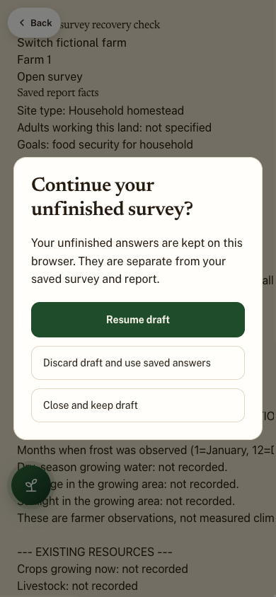
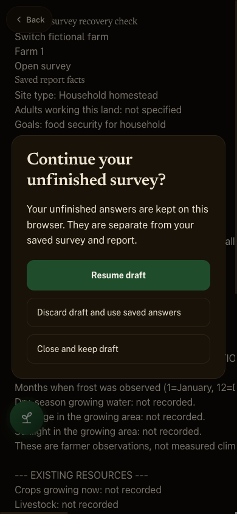
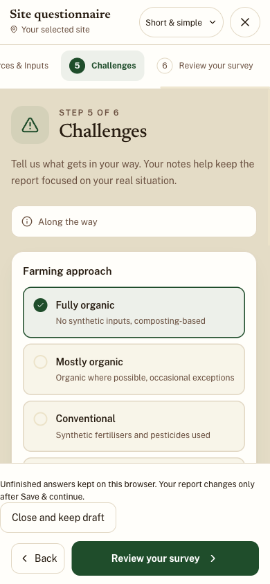

# Survey draft recovery and Ubhejane save/report check — 22 October 2026

Previous register: [2 October continuation](../2026-10-02/site-survey-continuation.md).
Base reviewed: `d99108f1` on origin/main. Branch: `codex/survey-draft-recovery-20261022`.

## SS-001 — implementation and browser evidence

The existing `lib/site-survey.ts` authority now keeps unfinished answers in a
separate browser-local row using the app's existing account namespace and canonical
site ID. These rows do not enter saved-survey events, cloud sync, completeness,
report facts or report prompts. Recovery requires an explicit Resume or Discard.
The editor also offers Close and keep draft. Its existing close/discard confirmation
remains available. Drafts are for this browser, not cross-device recovery.

Raw area, laying-hen and reporting-year inputs survive recovery, including invalid
entries that need correction. Detailed production, blank versus zero, notes and
hidden route fields survive. Switching comprehensive/short does not publish facts.
Successful explicit save clears the matching draft; failure retains it. A storage
failure is visible with a retry. An older tab cannot silently replace or discard a
changed draft row. Account changes reject late writes into another owner's namespace;
site changes mount a fresh editor. A changed saved survey blocks a stale open
editor's final save. A recovered draft warns if the saved survey changed meanwhile.

Real-component browser checks on fictional farms exercised:

- Close/keep, resume, reload and another farm's empty questionnaire.
- Negative roof input recovered unchanged; clearing it recovered a blank.
- Saved report context remained unchanged until explicit Save & continue.
- Comprehensive egg count of zero and its unit retained through the short route.
- Simulated saved-row write failure kept the editor open and the draft recoverable;
  retry saved the exact notes and zero quantity and removed the draft.
- Discard removed only unfinished changes and reopened the prior saved observation.
- Recovery and editor inspected at 390×844; recovery also checked at 1440×960.
  Light/dark recovery colours and the phone footer were visually inspected.

Browser checks are Chrome viewport tests, not physical Safari/device certification.
New recovery wording is English pending fluent review. Storage refusal and clearing
browser data can still prevent recovery; the UI does not promise cross-device backup.

## SS-003 — signed-in Ubhejane check

Opened the actual saved site in Rory's signed-in production browser. Reviewed the
existing questionnaire, saved its existing answers without entering fictional facts,
and reached the report preparation screen and deterministic five-page Field guide.
After a full page reload, selected Ubhejane again and reopened its review; the
same community, water, roof, resource and unknown-production answers remained.
The report retained mapped-versus-confirmed distinctions: growing space is labelled
as mapped, tank capacity is labelled as planned and needing installation checks.
Questionnaire review retained unknown cultivated area and installed storage as
not recorded; it did not infer animal stock from mapped housing.

No paid report generation, image render, photo upload or geometry edit was performed.
A new AI-written narrative and its cloud result were therefore not certified.
The current browser reported no saved rendered design-sheet images for this site;
the synced geometry and crop plan still supplied report figures. The missing image
appendix is a separate browser/device availability issue, not proof of survey loss.

## Verification and remaining work

Node 24 typecheck and 100 focused survey, source-pair, accessibility, account-storage,
completeness and report-fact tests passed. The full suite was started; its final
result, exact branch CI and preview state are recorded in the PR and issue #35.
No existing test assertion was removed. New storage checks cover account/farm
isolation, rejected late callbacks, corrupted drafts, storage failure, changed rows,
failed-save recovery, explicit cleanup and separation from report context.

SS-002 fluent review and SS-004 physical-device/Safari checks remain open. SS-003's
paid narrative generation is outside this check. Preserve the original dated audits;
continue these IDs in later verification.

This changes the picture: recovery choices and a draft status/action are visible.
`PLAN_VERSION`, saved geometry, species, lessons, rules and workflows are untouched.
The temporary QA route was removed; its local-only harness remains under output/.
