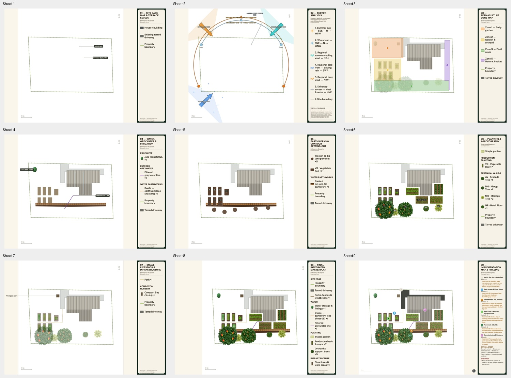

# Nine-sheet legend consistency audit — 26 October 2026

- Auditor: Codex.
- Reviewed base: `ca9beb090`, branch `codex/map-legend-consistency-20261026`, with the implementation in this branch.
- Deployment inspected: local development at localhost:4255; production has not received this legend change yet.
- Previous audit: [Ubhejane map recovery](ubhejane-map-recovery-codex.md); carries SS-001 through SS-006.
- Scope: all nine exact sheets, the shared final sheet compositor, Phasing, cached-image freshness.
- Evidence: source review, automated checks, browser rendering of the existing public fictional farm, measured pixels and inspected PNGs.

## What was already done

The previous audit restored current exact-map availability in the real Ubhejane
browser and preserved historical exports separately. Those existing bitmaps and
private farm records are retained. This follow-up implements Rory's request:
“same place same box same fonts”. It does not approve the site design or convert
planned works into observations.

## Findings and disposition

| ID | Problem | Status | Evidence |
| --- | --- | --- | --- |
| SS-007 | Only Water, Planting and Structures had a framed legend; Phasing owned separate spacing and smaller type | Implemented and locally rendered | One `drawSheetLegendPanel` and `sheetLegendPanelMetrics` now supply every sheet. Shared title, style and detail roles keep the font hierarchy consistent; Phasing paragraphs use the common detail role. |
| SS-008 | Compact masterplan's panel shifted inward; a long Earthworks heading clipped on its third line | Implemented and locally rendered | Spare horizontal paper is placed on the left, anchoring the panel at the right trim without adding duplicate leader gutters. Titles and style labels wrap completely. |
| SS-001–006 | Prior survey, language/device, delivery and historical-map findings | Prior dispositions retained | See the previous audit; no new physical-device, fluent-language or paid-narrative evidence. |

## Verification

- Final local typecheck passed on Node 24 after removing the temporary QA route.
- 111 focused legend, typography, map-agreement, presentation, phasing, paid-chrome, sheet-store and report-plate checks passed. No existing assertion was deleted. The old test pinning recipe `r5` was rewritten into its actual rule: pre-shared-panel images remain readable as older renders, while current-recipe images are current.
- Full final suite and exact-head CI are tracked in the PR and issue #35. An older duplicate local run from the recovery-only checkpoint was stopped before completion; it is not claimed as verification of this implementation.
- Whitespace was checked before commit.
- All nine renderer calls left the serialised state, frame and reference geometry unchanged.
- Each final image is 3462 × 2448. The dark outer panel occupies x=2842…3461 on all nine: identical position and 620px width, verified from rendered pixels. The first render caught the masterplan offset and the clipped Earthworks title; both were corrected and the complete set rendered again.
- The Phasing panel was inspected separately at full size. All six fixture phases, week ranges, hold points, critical order and retained site rule fit. Its existing fitting policy still sheds optional task bullets and surplus site rules before reducing legibility; it does not claim to print the entire underlying work schedule.
- Source/template verification also covers the shared final compositor used after paid styles, but no paid generation was performed. Actual model quality is outside this change.

[Measured panel bounds](evidence-legend-consistency/panel-measurements.json).

This changes the picture: newly drawn sheets share a framed cream panel and font
hierarchy; Phasing detail is more readable. `PLAN_VERSION` is unchanged. The
narrow render recipe moves from r5 to r6 so prior saved images remain available
and are identified as older drawings. No saved bitmap is overwritten or paid
regeneration enqueued automatically. A farmer must deliberately redraw to obtain
the new appearance. Species, lesson content, geometry, rules and workflows are
unchanged.

## Next continuation

Read exact-head checks on the PR before merging. After deployment, redraw a free
exact set to see the new template; existing images cannot change themselves.
Physical phone/Safari and fluent-language review remain separate open checks.
