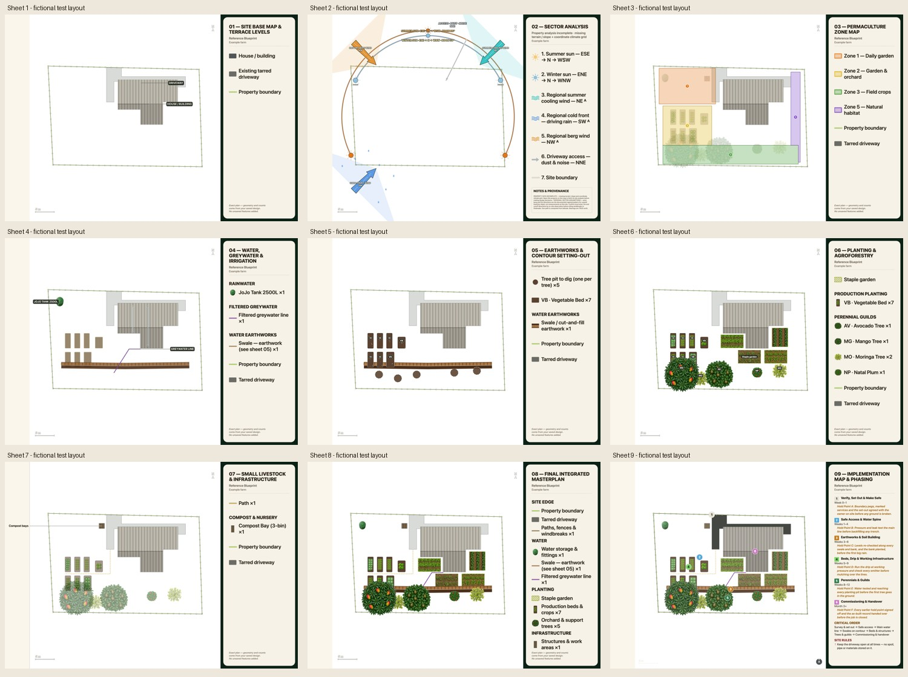

# Readable map legends and plain-paper buildings — 26 October 2026

- Auditor: Codex.
- Reviewed base: `b4f79a2a9a30ade39dd01413a6a57993f7291710`, the existing #1131 legend branch, with this continuation's changes.
- Deployment inspected: local development at `http://127.0.0.1:4257`; no production publication claimed.
- Previous audit: [Nine-sheet legend consistency](map-legend-consistency-codex.md), retaining its SS-007/SS-008 dispositions; [Ubhejane map recovery](ubhejane-map-recovery-codex.md), retaining SS-001–006.
- Scope: nine exact sheets, shared legend placement and typography, existing-site building paint and keys, Phasing, footer bounds and cached-render freshness.
- Evidence: source review, regression checks, actual browser-rendered PNGs, measured text/panel bounds and same-browser before/after comparison. Public fictional geometry is separate from real Ubhejane evidence.

## What was already done

#1131 supplies the shared frame, fonts, wrapping and right-edge alignment. This
continues it, rather than building another sheet renderer. Earlier real maps,
report PDFs and survey records remain preserved. The report-purpose, annual-plan
and market-evidence work remains in #1099/#1101, whose exact passing heads and
review handover are recorded in issue #35. No new report narrative or field
observation is claimed here.

## Findings and disposition

| ID | User-visible problem | Status | Evidence |
| --- | --- | --- | --- |
| MAP-L01 | Empty paper beside the Phasing key limits readable type | Implemented and locally rendered | Shared `calculateSheetLegendPlacement` gives an unused right leader band to the legend. Actual right-side leaders retain their full band; left-only leaders do not reserve an empty right band. The compact masterplan retains its right anchor. |
| MAP-B01 | A plain-paper base map names a building but leaves its footprint blank; another classroom can lose its name | Implemented and locally rendered | The no-source-cutout branch reuses `drawPaperRoofs` and authoritative footprints, above access surfaces. `existingSiteGroundRings` suppresses only the identical promoted house, retaining other buildings' names and keys. A separate synthetic second-building probe draws and names its classroom. |
| MAP-K01 | The property boundary can appear twice in the base-map key | Implemented and locally rendered | The dedicated line keeps its row; a boundary is excluded from the ground-surface list that never paints it. The new regression failed before the correction. |
| MAP-F01 | Larger lettering exposes a clipped default footer | Implemented and locally rendered | The complete wrapped footer and any imagery credit are measured before space is reserved, then drawn inside that space. |
| SS-001–008 | Earlier map/survey dispositions | Retained | See the linked records; no new fluent review, physical-device evidence or field approval. |

The first widened Phasing render made type grow with the entire new width and
clipped its final hold point. The final placement gives some width to fewer
wrapped lines and limits the type increase. All six phase titles, week ranges,
hold points, critical order and the retained site rule are visible. The existing
fit policy still omits optional task bullets; the #1131 baseline fixture already
omitted them. This sidebar is not the full underlying work schedule.

## Verification

- Public fictional farm: all nine final PNGs are 3462 × 2448. Every panel occupies x=2549…3461, 913px wide, compared with 620px previously. No map scale or canvas envelope was enlarged to obtain this space.
- Phasing detail: 33px versus 28px; shared titles: 58px versus 48px. All measured right and bottom text bounds fit within the content rectangle; the left inset was also checked visually. Six complete hold points and both concluding sections were checked.
- Before/after source was rendered in the same browser. Map-image pixels for sheets 02–08 match exactly after the compact masterplan's uniform paper offset is accounted for. Phasing's north marker moves to clear the wider key; 33 other edge pixels differ. No byte-identical Phasing claim is made.
- All renderer calls retained the exact JSON of their input state, frame and reference geometry. The extra classroom exists only in a cloned synthetic probe; no saved farmer geometry or public fixture was edited.
- Regression demonstration: the two new classroom/boundary tests failed against the prior selector (10 pass / 2 fail) before its correction.
- Existing source-wiring checks were carried into the shared placement authority and strengthened with runtime margin arithmetic. The reason for replacing inline-variable pins is recorded in each test; no coverage was deleted.
- Final ordered typecheck, full-suite and release-note/whitespace results belong in the PR and issue #35 after completion. An unfinished run is not a pass.
- Output inspected: all-nine composition contact sheet; full base and Phasing views; separate classroom probe; measured text bounds for every panel. All remaining legend keys were also inspected as full-resolution crops.
- Limits: local fictional rendering is not a new real-site plan, field approval, fluent-language review or physical phone/Safari evidence. No paid render or real-site Save.

[Measured bounds](evidence-readable-legend/panel-and-text-bounds.json) ·
[Base-map classroom probe](evidence-readable-legend/classroom-probe.jpg) ·
[Phasing example](evidence-readable-legend/sheet-9-example.jpg).

This changes the picture. `PLAN_VERSION` remains untouched. Recipe r7 identifies
new drawings while retaining r6/r5 saved images as older renders; no saved bitmap
is overwritten and no paid regeneration is queued. Existing drawings need a
user-triggered free redraw to show this template.

## Next continuation

Finish the exact-head verification and review handover before merging. After
deployment, deliberately redraw the real site's free exact set and check the
classroom against its saved trace, retaining its older exports and review status.
Claude review/merge of #1099 then #1101 is separately requested in issue #35; a
ledger request is not evidence that Claude has reviewed or merged them.

## 27 October integration checkpoint

Current main `55526909e` was integrated into the existing legend work. Only the
release history conflicted; both sets of entries and tours were preserved. All
six checked map-rendering/fixture modules retained their SHA-256 bytes across
that merge, so the inspected drawing source is unchanged. The six map release
descriptions have additive, unreviewed drafts in zu/st/ts/ve, preserving main’s
native update-history contract. Their exact source pairs are in
[the map release draft record](map-release-note-drafts.json); no fluent review is
claimed and no existing translation bytes were rewritten.

Ordered typecheck and 151 focused checks passed before the main integration.
Final combined checks, full-suite totals and deployment status remain for the
PR/issue handover after completion.

The first combined update-UI run caught that the newly visible map notes had
no guide stops: four refresh cases and four guide cases failed, one of each per language. Two concrete map
and report destinations now accompany the release, with additive unreviewed
phrase drafts. Existing localization assertions and manual-refresh behavior
were retained. Final passing counts are recorded after rerunning the checks.

Final combined pre-push checkpoint: Node 24 typecheck passed; all 195 focused
map, geometry, typography, Phasing, canvas, release-label and actual four-language
update-UI tests passed, zero failures/TODOs. Release-note drift and whitespace
passed. The full suite and exact-head CI remain separate completion gates,
reported in the PR/ledger once terminal results are available.
