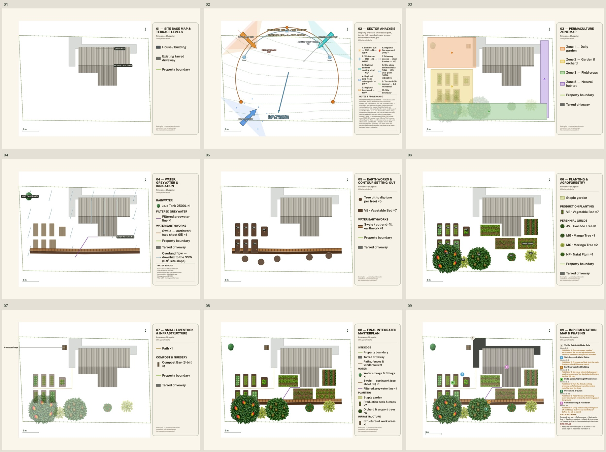
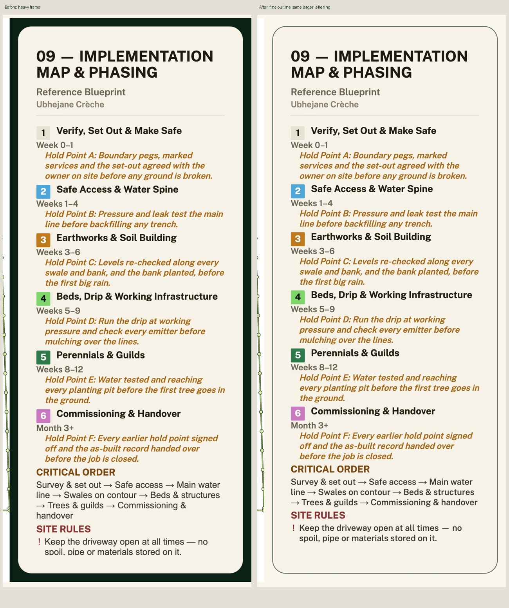

# Nine-map visual audit — 27 October 2026

- Auditor: Codex.
- Reviewed base: `6031467cd0174f0e77bdb67e40df336de18f594a`, integrated with published main `16bca4669` in `c1252591c`, plus this requested visual refinement on #1131.
- Deployment inspected: local `http://127.0.0.1:4261`, using a fresh module load. Final branch preview and production are separate gates.
- Previous audit: [Public-sample Phasing fit and new-render preview](phasing-public-sample-fit-codex.md), carrying MAP-L01/L02, MAP-B01/K01/F01 and SS-001–008 forward.
- Scope: all nine exact public-sample sheets, shared legend frame/type, metre ruler, north marker, evidence notes, common PDF envelope and saved-map redraw selection.
- Evidence: normal free app generation and PDF download; all-nine composition and full legend review; actual canvas glyph measurements; regression tests executing real paint/padding callbacks.

## What was already done

The wider right-hand keys, larger Phasing type, complete retained site rule,
plain-paper buildings, historical saved-map preview fix and prior recovery work
remain. Both full CI jobs for `6031467cd` passed before this additional request:
6,014 tests, 6,013 pass, zero failures and one existing TODO. Those results do not
certify this changed revision. Main’s annual-production, Record plan and dated
market-evidence work is preserved; both sets of release notes and audits survived
the integration.

## Findings and disposition

| ID | User-visible problem | Disposition | Evidence |
| --- | --- | --- | --- |
| MAP-L03 | The heavy dark-green legend band dominates the drawing | Implemented and rendered | Same cream card, padding and larger type; a fine green outline replaces the slab. Actual stroke is 2.838px versus a 33px straight green band in this sample. |
| MAP-L04 | Rulers are pale on paper; north marks differ between sheets | Implemented and rendered | One ruler painter supplies dark opaque ink with a paper halo. One compass style and common map-corner placement serve all nine sheets. The ruler retains its metre calibration. |
| MAP-L05 | Sector evidence notes are disproportionately small; an evidence marker can wrap alone | Implemented and rendered | Custom notes share the normal 27px footer scale in this sample. The complete mandatory text is retained; the regional marker stays with its bearing. Dense keys retain all rows across columns. |
| MAP-L06 | The compact masterplan’s smaller bitmap makes its key larger in the PDF | Implemented and rendered | All nine exported images are now 3783 × 2675. The common envelope adds paper without scaling or cropping the measured map. |
| MAP-L02 | Phasing’s final site rule was clipped | Retained and rechecked | All six hold points, critical order and the complete retained driveway rule are visible in the final export. |
| New-render preview | A selected historical row could mask the new result | Retained and checked through normal UI | Selected 3457 × 2444 historical masterplan → free Design map → fresh 3783 × 2675 main preview. Historical records remain; sample gallery reached 20 rows. |
| MAP-B01/K01/F01; SS-001–008 | Earlier map/survey dispositions | Retained | Earlier records remain authoritative. No new field approval, fluent review or physical Safari evidence is claimed. |

## Verification

- Inspected the final nine-page PDF, all-nine composition, all nine full keys in three readable strips, and full masterplan/Phasing views. Titles, symbols, notes and final lines fit.
- The actual browser recorder measured every legend after the correct fonts loaded: nine keys, identical 2.838px frame strokes, and no glyph crossing its active clipping rectangle. Full calls and counts are in the measurement files.
- Scale regression executes the real painter across several metres-per-pixel values and gutters: printed width equals stated metres × pixels-per-metre; gutters never alter the width; the label has at least 7:1 contrast on the paper. The unchanged regression was also run against the real older painter and failed for the pale label, as intended.
- Padding regression executes the real helper for wide, tall and compact compositions. The common paper dimensions match; each map is copied directly with no scaling/cropping arguments. The earlier inline-call syntax assertion was strengthened to require one shared size for placement and paper, with the reason recorded in the test.
- The old private custom-footer floor assertion now guards the shared reader size and preserved wording, with its reason recorded. No assertion was deleted to hide a failure.
- Final Node 24 typecheck and 502 focused map, typography, geometry, gallery, routing, paid-gate and four-language update checks passed before the additive final notice. The final ordered full suite and exact-head CI remain release gates; their terminal totals belong in the PR and issue #35, not an extra code push.
- Browser-emulated phone: 390 × 844, document width 390, rendered map width 343; no horizontal overflow. This is not a physical-phone/Safari check.
- Saved geometry, species names, farming values and schedule wording were not edited. The Sector/Water samples gained terrain/climate details from existing feeds between the older export and this run; that is evidence availability, not a new field observation or a new invented number. No whole-map byte-equality claim is made.
- The first export selection included the earlier batch; the PDF image-size check exposed that. The final archived/exported set uses the appended batch and all nine image dimensions match.
- A development service-worker code cache was cleared only in the isolated localhost verifier, preserving saved map records, before the final capture. No production-user cache was cleared.
- This changes the picture. `PLAN_VERSION` is untouched. Recipe r8 retains older saved/paid bitmaps as older renders. No image is overwritten or automatically charged for regeneration.
- Limits: public sample only; no real farmer Save or paid AI generation. One additive update-description draft is explicitly unreviewed in zu/st/ts/ve, with exact source pairs in [the draft record](map-visual-release-note-drafts.json). Existing native wording and course content are preserved.

[Keys 01–03](evidence-map-visual-audit/legend-review-1.jpg) · [Keys 04–06](evidence-map-visual-audit/legend-review-2.jpg) · [Keys 07–09](evidence-map-visual-audit/legend-review-3.jpg) · [Measurement summary](evidence-map-visual-audit/measurements.json) · [Actual glyph bounds](evidence-map-visual-audit/final-glyph-bounds.json).

## Next continuation

Finish the final ordered checks and exact-head CI, merge the user-authorized
#1131 release, and verify the production SHA. The normal saved-map redraw flow
must show the new key while retaining old drawings. Existing bitmaps require a
deliberate free redraw after refresh to acquire this template.

## Release integration after the visual audit

The final rendered revision `f87f10f4` completed the local ordered checks:
6,041 tests, 6,040 pass, zero failures, one existing shape-sync TODO. The
branch CI run [40472525968](https://github.com/rorymclark-prog/ImbewuField/actions/runs/40472525968)
also passed with those totals. While the PR job was finishing, production
advanced to `31d0ba801` through #1125 (waves 24–27), creating conflicts in the
audit index and release notes. Both entries are retained in this integration;
all four locale dictionaries merge additively. Main’s offline, theme, keyboard
and plain-error changes are retained. The map painters and the recorded nine-map
PDF are unchanged by the integration. The combined revision has its own ordered
checks and exact-head CI gate; the earlier passing result is historical evidence,
not a substitute. Final results are recorded on #1131 and issue #35.

## Current-main release continuation — 27 October

The combined head `b0ef2ea72` completed both test/rules runs successfully. Before
release, main advanced again to `9d42fedbe` (#1136, keyboard focus in overlays),
so the open PR became conflicting. The recovery checkout integrates that main
at `eb7a69bb6`. The two manual conflicts are the audit index and release history;
both sides are retained. Four native update dictionaries merge additively, and
the canonical test command retains every argument from both prior heads.

The six checked drawing modules (`DesignGlossy`, reference presentation, shared
legend layout, render recipe, cartographic symbols and glossy filters) are
byte-identical to `b0ef2ea72`. The recorded nine-sheet rendering is still the
rendering source under review; keyboard behaviour has its own current-main tests.
No new map painter or geometry change was made for this integration.

Rory's downloaded `codex-handoff-results-2026-10-27.md` was read and compared with
the shared handoff record. Report PRs #1099 and #1101 are merged. Record plan is
already present in Design Studio's Preview & export, with PNG/SVG download and
Add to maps; rebuilding that option would repeat completed work. The updated
Ubhejane sample is being prepared using the existing public demonstration mode,
separate from real field evidence and the preserved original six reports.

The first release-note drift check identified the integration and new keyboard
commit after the earlier stamp. The map entry now covers `eb7a69bb6`, retaining
all existing farmer-facing descriptions and four-language draft strings. Ordered
checks and fresh exact-head CI certify this combined source; older green heads
are historical evidence only. Final totals and production verification belong in
the PR/issue handover. PLAN_VERSION and recipe r8 are unchanged.
