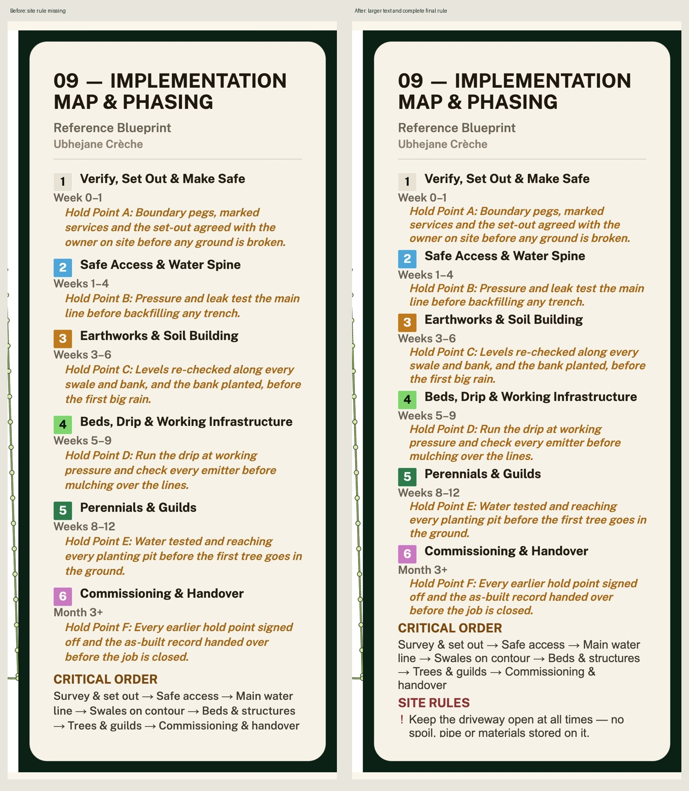

# Phasing public-sample fit audit — 27 October 2026

- Auditor: Codex.
- Reviewed revision: `f7e2e3482ad7bcac750bd8d405466c8bd3f9c0be` plus this Phasing spacing correction, on PR #1131.
- Deployment inspected: `https://imbewufield-map-legend-consistency-20261026.vercel.app`, build `264342bed`; corrected source inspected at `http://127.0.0.1:4258`.
- Previous audit: [Wider legends and paper buildings](../2026-10-26/map-readable-legend-buildings-codex.md), carrying MAP-L01/B01/K01/F01 and SS-001–008 forward.
- Scope: the public Ubhejane example, normal Design Studio free nine-sheet generation, gallery, PDF and full-size Phasing download. This is sample content, not a new field survey or farmer approval.
- Evidence type: browser workflow, actual exported PDF, full-size PNG, visual comparison, recorded canvas glyph bounds and source review.

## What was already done

The shared cream frame, wider margin placement, larger typography, paper-building fix and recipe r7 remain. The earlier synthetic render fitted its schedule. That evidence did not establish that the longer public sample would also fit. No saved farmer geometry, timing, species, schedule wording or paid image was edited.

## Findings and disposition

| ID | User-visible problem or coverage gap | Status | Evidence and next action |
| --- | --- | --- | --- |
| MAP-L02 | Public Ubhejane Phasing loses the site-rules section after the wider typography | Corrected and locally rendered; final CI/publication pending | The deployed `264342bed` nine-page PDF ends the schedule at critical order. The revised reading rhythm retains 33px detail text and makes the complete first site rule visible. All six hold points and critical order remain. |
| MAP-U01 | Creating a new map while a historical row is selected leaves the old map on screen | Reproduced in deployed `8a59db5`; shared rerun corrected, deployed recheck pending | The gallery grew from 3 to 4, but the older Phasing row stayed selected and hid the fresh image. Selecting the new row exposed the corrected rule. See the continuation below. |
| MAP-L01/B01/K01/F01 | Earlier width, paper building, duplicate key and footer findings | Retained | This follow-up changes only Phasing paragraph spacing. The nine-page preview PDF was visually inspected; the corrected Phasing sheet was downloaded at full size. |
| SS-001–008 | Earlier survey/map findings and review limits | Retained | Previous records remain authoritative; no physical phone/Safari or fluent-language review was added. |

The existing fit policy omits optional task bullets and surplus site rules. This correction retains the same schedule content policy and its first complete rule; it does not claim that the sidebar includes every underlying task or site rule. The publicly available example is separate from the user's saved field records.

## Verification

- Normal preview workflow generated nine sheets and exported a nine-page PDF. All nine compositions were inspected together; Phasing was inspected separately at full size.
- Corrected local normal workflow generated the same nine-sheet set. Its Phasing PNG is 3783 × 2675; the underlying schedule canvas is 3783 × 2202.
- Actual schedule clip: x=2941, y=33, width=738, height=2065. All 47 recorded schedule text calls fit horizontally and vertically, including their ascents and descenders. The final rule has 35.69px of bottom clearance. The complete driveway rule and six hold-point labels are asserted in the evidence check.
- Source typography remains 33px for detail/hold points and 58px for the main title. Only line and paragraph spacing changed in this follow-up.
- The revised image was visually inspected after download: every hold point, critical order and the complete final driveway rule are visible, with the same cream card, dark frame and font family.
- Final Node 24 typecheck and all 252 focused map, typography, Phasing, geometry, release and practice-history tests passed, with zero failures/TODOs. The full suite was started after a successful typecheck; final terminal totals and exact-head CI belong in the PR/issue #35 handover. In-progress checks are not passes.
- Whitespace check passed. `PLAN_VERSION` remains unchanged. This changes the picture.
- Limits: sample mode warned that its images were not saved persistently on this device; the full-size download and PDF were retained separately. No real farmer Save or paid generation was attempted. A signed-out location request returned 401. The developer-only capture endpoint rejected the full PNG; normal Download succeeded. Neither event is claimed as a production crash or a successful persistence test.

[Full corrected composition](evidence-phasing-sample-fit/phasing-final-review.jpg) · [Recorded glyph bounds](evidence-phasing-sample-fit/phasing-final-text-bounds.json).

## New-render preview continuation

The subsequent normal workflow check applied the deployed `8a59db5` update,
selected its older saved Phasing row, then chose Design map. The new drawing was
created and retained, but `railPreviewImage` still took precedence over the fresh
result. The older selected row remained on screen without SITE RULES. Selecting
the newly created row showed the complete corrected rule. This was reproduced
again with the saved-map count increasing from four to five; it is a selection
defect, not a claim that generation failed or a paid request occurred.

The single shared `runCurrentSheet` entry now clears that historical preview
before dispatch. It also marks this site/sheet's auto-preview intent, so late
gallery metadata cannot reopen the old row. All eight exact/queued/analysis
dispatch paths keep their existing routing and return values. No saved row is
removed and no renderer, schedule content, pixel recipe or geometry is changed.

Eight runtime regression cases extract and execute the actual rerun callback
from the component. All eight failed before correction because the selected
historical preview was never cleared. They now check clearing and the late-load
guard before each renderer is invoked. Node 24 typecheck and all 578 focused
gallery, map, Phasing, geometry, routing, paid-render gate, release and practice
checks pass, zero failures/TODOs. No existing assertion was changed for this fix.
Final full-suite CI and the deployed before/after selection check remain gates;
the PR/issue handover records their terminal outcomes rather than calling an
incomplete run a pass.

## Next continuation

Finish exact-head test and rules checks for #1131, merge the authorized release, then verify the production build SHA. Existing saved bitmaps remain preserved; obtaining this template requires a deliberate free redraw after refresh. Production publication is a separate gate from this local visual verification.
