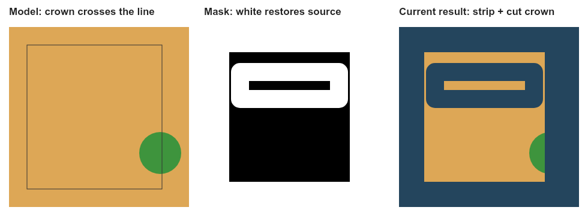

# Paid AI map composition audit — 2026-10-28

- Auditor: Codex, responding to Rory’s screenshot of the whole-design sheet.
- Reviewed revision: production `9e11f2396dadc84c2a8fb07bb89162007ba9e245`; audit branch `codex/ai-map-composition-audit`. Application code is unchanged.
- Deployment inspected: `https://imbewufield.vercel.app/api/build-info` returned `9e11f23`. User screenshot, original paid input/output/mask/source and the production finisher were inspected; no new browser render or paid generation was requested.
- Previous audits: [render audit implementation](../../RENDER-AUDIT-IMPLEMENTATION-2026-09-04.md), [plant-art asset audit](../../PLANT-ART-FINAL-AUDIT.md), [historical render investigation](../../RENDER-INVESTIGATION-2026-07-20.md), and [latest mapping/report integration](../2026-10-26/site-report-role-integration-codex.md).
- Scope: paid whole-design and planting assembly; shared mask policies for the six design-layer filters; roof/boundary overlays; exported claims; whole-sheet label controls; comparison coverage. Other analysis-sheet paths and older direct handlers received source review only.
- Evidence type: original paid-image comparison, source review, actual compositor execution, synthetic pixel reproductions and focused checks.

## What was already done

PRs [#1139](https://github.com/rorymclark-prog/ImbewuField/pull/1139) and [#1140](https://github.com/rorymclark-prog/ImbewuField/pull/1140) recovered the paid planting image, added its existing labels/chrome successfully, and shipped white paper, a finer legend frame and catalogue artwork in legend keys. Those improvements remain. This audit does not reopen their verified aspect-registration or legend-asset results.

The earlier paid visual check exercised **Planting**, while the later screenshot is **Whole / all**. Whole applies an additional effort-zone mask rule. The nine-sheet montage from the prior task exercised exact builders; it was not a nine-sheet paid-output comparison. That coverage distinction explains how these defects remained despite green tests.

The July `ghost-vetiver` findings concern prompt/icon interpretation. The present broad photographic strips are reproduced without a model call and come from post-generation restoration. They are new findings, not evidence that every historical prompt finding has recurred. The September audit’s saved-scene, revision, raw-output retention and gallery review-status protections remain; its review-status claim does not establish truthful wording inside an exported PNG.

The raw whole-map AI artwork has continuous ground, complete tree crowns and one model-drawn treatment per roof. Restoring source pixels introduces the broad internal strips and cuts the crowns; the subsequent structure overlay introduces the extra grey roof treatment. The complete existing finisher reproduced the supplied screenshot. No saved scene, photo registration, item position, measured size or boundary was changed.

## Findings and disposition

All findings below remain **open**. This is an audit, not a production correction.

| ID | Priority / user-visible problem | Status | Evidence and correction required |
| --- | --- | --- | --- |
| AI-MAP-001 | **P1 — photographic “ghost” strips cross the paid whole-design artwork.** | Visually and synthetically reproduced | `buildProtectMask` (`components/design/DesignGlossy.tsx:1421`) strokes effort-zone outlines at `10 * SCALE`. It uses `zonesInFilter`, which includes `all`. Painted-style policy disables unmarked-ground/house/driveway protection but never disables these zone bands. `restoreProtectedPixels` then copies source photographs into them. Keep effort-zone protection on the dedicated Zones sheet; do not restore analysis-zone outline bands through a painted whole-design illustration. Do not remove zones from the saved design. |
| AI-MAP-002 | **P1 — tree crowns are sliced at the property line.** | Visually and synthetically reproduced | `lockedProtectMaskOptions` sets `protectOutside: true`; `buildProtectMask:1374` protects the whole exterior and adds an inward boundary band. Consequently the AI crown outside the line is replaced by source pixels. The viewport already includes canopy extents (`presentationExtentRing:7104`), so widening the crop alone cannot correct this. Separate factual land protection from permitted planned-canopy foreground overhang. Keep the actual boundary and item centres unchanged; permit foliage beyond the line without making all neighbouring land editable. |
| AI-MAP-003 | **P1 — extra grey roofs sit over or beside the AI roofs.** | Visually reproduced by stage comparison | `buildPaintedStructureOverlay:3036` always draws `drawPaperRoofs` at the saved footprints. It does not remove or reconcile the roof the model already painted. The completed whole sheet visibly retains parts of both treatments. Give each roof one material/appearance owner. Preserve the authoritative saved footprint, but do not ship an opaque second roof as a geometry cue. Verify the result over this same existing artwork rather than changing the farmer’s tracing. |
| AI-MAP-004 | **P1 — property boundary is keyed in the legend but the locked paid master has no independent exact boundary pass.** | Source confirmed; reproduced output inspected | `finishStyledSheet:13454` deliberately passes no `boundaryPx` when locked. That suppresses both clipping and the boundary stroke in `compositeAccurateMap`. The remaining restoration band can erase the model’s fence, while `burnExactLabelLayer` and `composeStyleSheet` do not draw a property line. The Full Treatment chrome helper separately calls `drawBlueprintBoundary`; the offered Hybrid path does not. Draw the saved boundary independently of land clipping/restoration, with an explicit order relative to overhanging foliage. Do not substitute a hard image cut for a survey line. |
| AI-MAP-005 | **P1 — exported AI artwork promises “Exact plan” and “No unsaved features added.”** | Source and visible exported footer confirmed | The locked Hybrid calls `composeStyleSheet(..., exactGeometry=true)`. Its `exactGeometry` branch (`DesignGlossy.tsx:10944`) writes those claims into the downloadable image, although the surrounding app correctly labels it AI Polished / review against exact map. A saved legend inventory does not prove the model drew the same counts and positions. Carry result provenance into the exported chrome; reserve the exact/no-added-feature claim for deterministic exact sheets. Flipping `exactGeometry` to false alone is insufficient: its other footer branch also claims that elements are exact. Keep AI review status visible in standalone downloads. |
| AI-MAP-006 | **P2 — “On plant” is offered for Whole but individual plant names are not drawn.** | Captured selection and source confirmed; full reproduced sheet inspected | The submitted scene selected `onplant`. The control promises “full name under each plant”, yet `drawPlantMarks:6537` immediately returns when `sheetElementNaming('all')` is grouped. Whole also omits the individual-name gutters. Grouped whole-farm legends are intentional; the control needs to explain that mode or offer an actually supported labelling presentation instead of promising names it does not draw. No species name needs changing. |
| AI-MAP-007 | **P2 — source-photo footprint seams return in the surrounding context.** | Source and restored image visually confirmed | The frozen source already contains a sharp registered-photo inset over softer satellite. Its top/bottom transitions are visible in the uploaded composite and are restored into the finished surroundings; they are not generated by the image model. Review a presentation-only edge blend/colour treatment outside the factual design, retaining the source and its registration. Do not move/re-warp geometry or invent surrounding land to disguise this seam. |
| AI-MAP-008 | **P2 — current checks can pass all the above.** | Coverage gap confirmed | The protected-pixel check verifies that copied bytes match their source; it does not decide whether an effort-zone band should have been protected. Global changed-image scores can also pass a generally redrawn map containing severe local strips. The 164 relevant checks pass alongside the reproduced defects. Add failing regional acceptance checks for whole-design zone bands, crown overhang, independent boundary drawing, roof reconciliation and truthful exported provenance. Include cold-cache recovery and both current queue engines. Older direct handlers have different boundary-clip rules and also need a reachable-path review. |

## Evidence

This public figure contains **fictional geometry and solid colours only**. No personal farmer image, scene JSON, job identifier, credentials or raw log is committed.

The reproduction called the current `lockedProtectMaskOptions('all', 'precision_atlas', true)`, `buildProtectMask` and `restoreProtectedPixels`:

- Logical frame: 100 × 100; print scale 3; raster 300 × 300.
- Property rectangle: normalized `(0.10, 0.10)` to `(0.85, 0.90)`.
- Effort-zone rectangle: `(0.20, 0.25)` to `(0.75, 0.40)`.
- Factual source: RGB `(36, 69, 93)`; model ground `(221, 167, 86)`.
- A synthetic saved `tree_other` item has centre `(0.84, 0.70)` and a 70-raster-pixel canopy footprint. These are test coordinates, not planting advice.
- Model canopy: RGB `(62, 148, 61)`, centre `(252, 210)`, radius 35 raster pixels. It crosses the property line while staying inside the image.
- Pixel `(150, 120)` changes from model ground to source blue: unwanted interior zone strip.
- Pixel `(278, 210)` changes from canopy green to source blue: lost overhanging foliage.
- Pixel `(235, 210)` stays canopy green: the crown is retained only on its interior side.

The [six-filter mask matrix](evidence-ai-map/synthetic-policy-matrix.json) records mask alpha, where 255 restores source and 0 retains model artwork. The interior effort-zone sample is protected on `all` and `zones`, but not on `water`, `earthworks`, `planting` or `structures`. The overhanging-crown sample is protected on all six. This distinguishes the whole-only ghost-band defect from the shared outside-mask rule. It is a **current-defect reproduction**, not a desired-behaviour regression test to pin permanently.

Private stage comparisons were retained only in the ignored local cache. The actual paid output was examined before registration, after registration, after restoration using the uploaded input, after restoration using the frozen cropped photo, and after the complete current finisher. Only AI artwork was normalized for the known 16-pixel output-grid rounding. The detached saved scene remained byte-identical throughout.

## Verification

- Typecheck: `npx tsc --noEmit` passed.
- Focused checks: **164 pass, 0 fail**, including image-producer, paid-render gate, locked flow, chrome-after-AI and legend agreement.
- Full test suite: `npm test` passed — **6,068 pass, 0 fail, 1 existing shape-sync TODO** (6,069 total), 3,910 seconds. This is current source/regression evidence, not evidence that the pictured defects are corrected.
- Whitespace: `git diff --check` passed before the finished audit push.
- Output inspected: user screenshot; actual original paid input/output/mask/source; restored and fully composed whole sheet; synthetic reproduction and six-filter mask matrix.
- Limits: actual provider evidence is GPT Image 2.5 Sunburst, Reference Blueprint, Hybrid / whole sheet at High. No new Gemini, Photo Plan, dedicated analysis-sheet or second-pass provider image was purchased. Their source-path review is not a new visual verification. Native local composition uses Arial and rounds unsupported intermediate font weights; the image-mask findings do not depend on that font substitution. No physical-phone test was performed.
- This audit **does not change the picture**. The proposed corrections will. `PLAN_VERSION`, render recipe, source files, saved geometry and all existing paid outputs remain unchanged. No deployment was made for this audit.

## Next continuation

1. Correct the painted-style mask authority for Whole and planned canopy overhang together. Cover the existing persisted paid job, not only future mask generation: its old mask is already stored. Derive any revised presentation mask from the frozen scene, retain the original mask/output, and do not enqueue another model job. Keep an explicit, verifiable protection policy rather than bypassing the pixel verifier. Preserve the dedicated Zones-sheet semantics and factual background elsewhere. The synthetic reproduction must then keep model ground at the zone sample and retain allowed foliage at the overhang sample.
2. Draw the exact property line independently of background protection. Keep saved coordinates and all metre dimensions unchanged. Verify a complete crown crossing the line and an otherwise factual exterior.
3. Reconcile the roof treatment against this same paid output. A clean result has one roof per saved building, without raw-photo strips, opaque replacement slabs or a second AI silhouette showing around the replacement.
4. Correct standalone AI export provenance and the Whole-sheet label-mode promise. Retain deterministic exact exports and their legitimate exact-plan wording.
5. Review the photo-edge seam separately. Do not treat the registered source footprint as an invented AI object or quietly change source registration.
6. Run regional pixel regressions and inspect complete rendered images for the six design-layer filters, both current queue engines and cold-cache job recovery. Cover whole-design modes explicitly, rather than extrapolating from Planting. Use the existing paid raw image for visual verification; there is no need to commission another image merely to test post-processing.
7. Keep the earlier good saved versions available. Publish a corrected illustration only after its complete map, boundary, labels, legend and exported status have been inspected. Record the fix’s own branch/CI/deployment separately from this open-findings audit.
