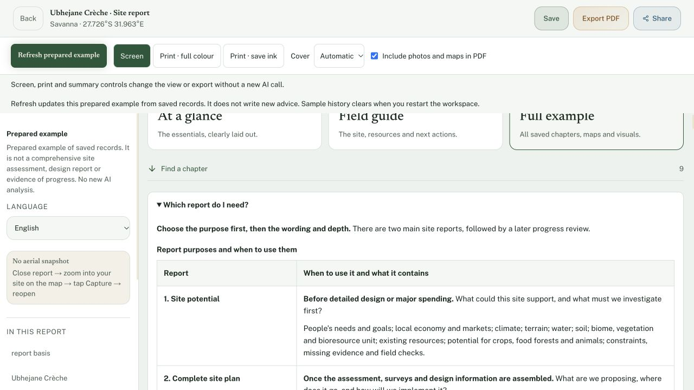
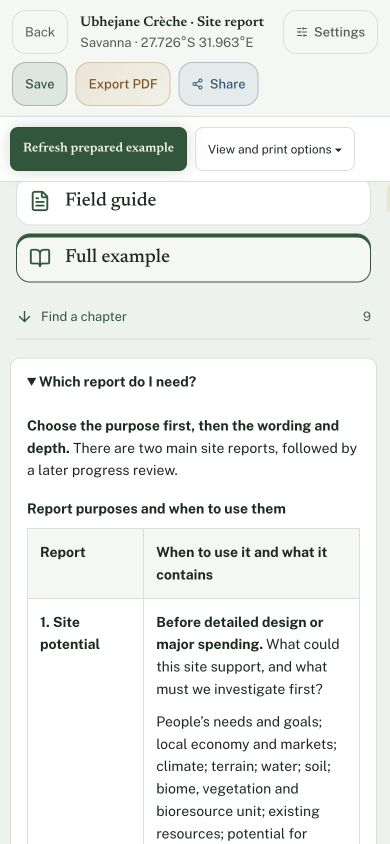
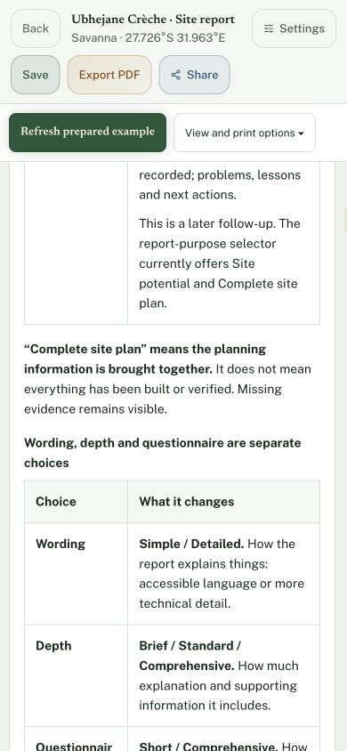

# Report choice guide - 29 October 2026

- Auditor: Codex.
- Reviewed revision: parent #1137 `2d14bdaffb6762b515c8e3b79e64e08be117f2d8`, with this guide-only follow-up on `codex/report-choice-guide-20261029`.
- Deployment inspected: localhost:4265; production publication remains a separate gate.
- Previous audit: [Release continuation](map-report-release-continuation-codex.md), [report purpose handoff](../2026-10-27/site-report-handoff-results-claude.md). Existing MAP/REP-L01/REP-S01 dispositions remain with their releases.
- Scope: existing report workspace's Which report do I need? disclosure, its CSS and update guide.
- Evidence: source, typecheck, existing report/localisation/readability tests and normal public-tour browser navigation. No real farmer records were saved.

## What was already done

The app already offers Site potential and Complete site plan. Wording and depth are independent controls; a progress review is a later follow-up, not a third selectable purpose. This extends the existing guide, preserving the English-language disclosure, saved-reading-view explanation and missing-evidence distinction. It adds no duplicate report generator or new report mode.

## Findings and disposition

| ID | User-visible gap | Status | Evidence / next action |
| --- | --- | --- | --- |
| REP-G01 | People could confuse report purpose with short/full editions or simple wording | Implemented and visually checked | Two comparison tables explain stage, question, contents, wording, depth and questionnaire. Comprehensive with Simple wording is explicitly valid. |
| REP-G02 | Complete site plan could be mistaken for completed or verified construction | Implemented and visually checked | Explicit caveat, proposed/recorded production distinction, and later progress review retained. Progress review's absence from the purpose selector is disclosed. |
| REP-G03 | Wide comparison tables could force phone users to pan sideways | Verified on emulated phone | Two-column wrapping layout; 390px viewport and document, 367px guide, 333px tables with matching scroll widths; 14px guide text. Desktop 1280px also inspected. |

## Verification

Initial typecheck passed. All 17 existing report-generation, preparation/localisation and readability checks passed; all 55 update-guide/native-notice checks passed. No tests or assertions were removed or weakened. Final ordered typecheck/full suite/whitespace and exact-head CI remain required; terminal results belong on the PR and issue #35.

Both tables, final caveat and plain-language recommendation were inspected in the normal report UI. Screenshots are below. The 390px check is browser emulation, not physical Safari. This changes the report workspace guide; exported report content, report generation settings, saved geometry, farming figures, species and PLAN_VERSION are unchanged. The guide remains English with its existing visible disclosure for other report languages. The update notice reuses existing exact English/native pairs rather than claiming a new translation review. No paid AI call occurred.

## Next continuation

Finish the guide's full gates, merge #1131 then #1137 then this stacked follow-up, and verify production source and expanded guide. Preserve original dated Ubhejane reports; private sample format previews from 27 October keep their 3 October evidence and 2 October drawing dates. Actual saved-map/calendar live verification remains separate from the public-tour guide check.
